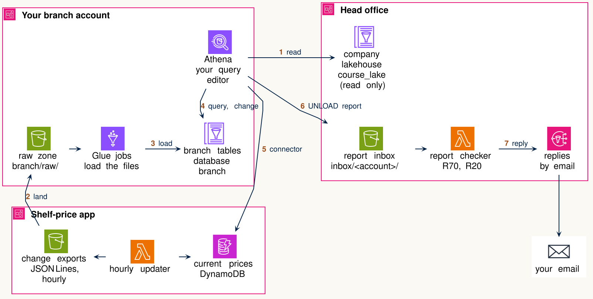

# 💼 Case

You have joined the data team of the Lyon branch of a national grocery chain. Head office runs the company
lakehouse (a lake whose tables have a table format and a catalog, L10), which holds:

- three years of receipt lines from every store's loyalty cards (the table `consumption`), kept as Parquet files in an Iceberg table, one partition
  per month;
- the product catalogue, which is Open Food Facts, the open database of products sold in France, with each product's
  Nutri-Score and NOVA grade;
- the stores, and the households in the loyalty programme (the branch calls them members);
- price observations from Open Prices, crowd-sourced and real.

Nutri-Score is a five-grade scale from A, the healthiest, to E, and the catalogue also marks some products unknown
or not applicable. NOVA is a four-group processing scale on which group 4 is ultra-processed.

Every branch can read the company lakehouse, and no branch can change it. In this course, the company lakehouse is
the course tables you registered in tutorial 1 as the data source `course`.

Dean, head office's data architect, built the company lakehouse in a weekend: three years of receipt lines in one
load, one partition per month, done. It has worked well enough that nobody has reorganised it since. When a branch
asks for a layout that suits it, Dean's answer is the same every time: "Build what you need in your own lake." That
is part of why the Lyon branch keeps a lake of its own.

The Lyon branch also has data that head office does not keep: the daily export from its own tills, the price
changes its shelf-price app records during the day, and changes to its own members' records, including requests to
be erased from the branch's systems. The branch keeps that data itself and queries it together with the company's.

Head office shares the company lakehouse with every branch under four data-use rules:

1. A branch may read every company table, and copies only its own stores and members into its own systems.
2. When a member asks to be erased, the branch removes the member's record and receipt lines from every table and
   file it keeps, within 7 days.
3. Reports a branch sends to head office hold aggregates only, never one member's rows.
4. A branch keeps its raw files for 30 days, unless rule 2 requires removing them earlier.

The branch director asks you to set up the branch's own lake beside the company lakehouse, keep its data correct,
and keep it cheap to run. They need your help with four tasks: a monthly report from the company lakehouse, loading
the branch's own files into the branch lake, keeping the branch's copy of its members correct as new requests
arrive, and a plan that keeps the branch lake correct and cheap to run for the year.

Sam, the branch's previous data engineer, moved to head office's data team last month and left a journal of notes, one entry for each task.
Sam's notes are below each task, unfinished: use them as a starting point, not as answers.

The households and their receipts, and the branch's files, are generated by us on top of the real catalogue,
prices and store locations, so that the assignment has answers we can check.

## What lives where

::: {.column-page}
{fig-alt="Three AWS accounts. Your branch account: Athena (your query editor), the raw zone, Glue jobs, and the branch tables. Head office: the company lakehouse (read only), the report inbox, the report checker and email replies. The shelf-price app: an hourly updater, its change exports and the current prices in DynamoDB. Arrows: 1 Athena reads the company lakehouse; 2 the change exports land in the raw zone; 3 Glue loads the raw zone into the branch tables; 4 Athena queries and changes the branch tables; 5 Athena reads current prices through a connector; 6 Athena UNLOADs a report into the inbox; 7 the checker replies by email."}
:::

::: {.column-page}
```{=html}
<table class="table" style="font-size: 0.92em">
<colgroup><col style="width:14%"><col style="width:28%"><col style="width:29%"><col style="width:29%"></colgroup>
<thead>
<tr><th rowspan="2"></th><th rowspan="2">Company lakehouse<br>(head office's, read-only to you)</th><th colspan="2" style="text-align:center">Branch data (your responsibility)</th></tr>
<tr><th>Bronze: the raw zone<br>(files as they arrived, L8)</th><th>Silver: <span class="chg">the branch tables</span><br>(Iceberg tables, typed and queryable, L8, L10)</th></tr>
</thead>
<tbody>
<tr><td>What is there</td><td><code>consumption</code> (the receipt lines), <code>products</code> (Open Food Facts records as published), <code>catalogue</code> (one row per product, with its grades), <code>stores</code>, <code>households</code>, <code>prices</code>, <code>current_prices</code></td><td>the branch's files as they arrive: till exports (CSV, one file a day), the shelf-price app's <span class="chg">price-change exports</span> (JSON Lines, one JSON record per line, one file an hour), changes to members' records (JSON Lines)</td><td>the tables you build: <code>branch.receipts</code>, <code>branch.price_events</code>, <code>branch.members</code></td></tr>
<tr><td>Where it is</td><td>the course account's catalog, database <code>course_lake</code>, read in Athena as <code>course.course_lake.&lt;table&gt;</code></td><td>your bucket, <code>s3://436c-glue-&lt;account&gt;/branch/raw/</code></td><td>your Glue database <code>branch</code>, data under <code>s3://436c-glue-&lt;account&gt;/branch/tables/</code></td></tr>
<tr><td>What you can do</td><td>read</td><td>read and add files</td><td>create, change, compact, delete</td></tr>
<tr><td>What it costs you</td><td>Athena, $5.50 per TB of Data scanned, 10 MB minimum per query</td><td>S3 storage, far below a cent for the assignment's files</td><td>Athena per TB of Data scanned, and Glue $0.44 per DPU-hour for each load</td></tr>
</tbody>
</table>
```
:::

[The report you deliver to head office in task 1 is gold, the level shaped for one consumer. Here it is built
straight from head office's tables. L8 and Strengholt's [*Building Medallion Architectures*, ch. 1, "What Is a Medallion Architecture?"](https://learning.oreilly.com/library/view/building-medallion-architectures/9781098178826/ch01.html)
describe the three levels.]{.chg}

The shelf-price app also keeps the price each Lyon store shows right now in its own DynamoDB table, which Athena
reads through a Lambda connector as `shelf.default.course_shelf_prices`. That is a federated query: Athena reads a
source outside the lake through a connector (L10).

📚 **Lecture:** L10 (Iceberg tables, catalogs, engines), L11 (building, changing and maintaining tables, their bills)
and L12 (DynamoDB); tutorial 1 ran a load twice.

## Director's requests, as requirements

The branch director's requests and head office's data-use rules, written as requirements in L9's EARS form (WHEN / IF … THEN … SHALL). The
system is the branch lake you build. Each task below says which requirements it works on.

| | Requirement | Its constraints | Tested by | Task |
|:--|:--|:--|:--|:--|
| R10 | BRANCH LAKE SHALL read company data only from the company lakehouse, and keep the branch's own data in the branch's account | the company tables are read-only to every branch | the company tables' snapshot lists do not change; your tables are in database `branch` | all |
| R11 | BRANCH LAKE SHALL copy only the branch's own stores and members from the company lakehouse | Lyon stores are those with `city` = 'Lyon'; Lyon members have `is_lyon` true (data-use rule 1) | every row of every copy you make meets the Lyon condition | 3 |
| R20 | WHEN the branch director asks for the monthly healthier-basket report<br>BRANCH LAKE SHALL deliver, for each month, the share of spend on Nutri-Score A and B products for Lyon households and for the rest of the company | columns `month`, `segment`, `ab_share`; JSON Lines, in head office's inbox; its Data scanned predicted before it runs | head office's reply (accepted, or returned with the reason); your prediction row in `results.csv` | 1 |
| R30 | WHEN the day's till export lands in the raw zone<br>BRANCH LAKE SHALL load it into `branch.receipts` | partitioned by day | rows in `branch.receipts` for that day against the row count in `_files.json` | 2 |
| R31 | WHEN the nightly price load runs<br>BRANCH LAKE SHALL load every price-change export since the last successful load into `branch.price_events` | every night; the cost of a month of nightly runs known before the director approves it | rows loaded against lines in the export files; your price table for Glue and for an EMR cluster | 2 |
| R40 | IF a load runs a second time on the same input<br>THEN BRANCH LAKE SHALL keep one copy of each row | applies to both loads | rows for the input against the input's own count after a second run; the snapshot list | 3 |
| R50 | WHEN a change file for the branch's members arrives<br>BRANCH LAKE SHALL apply it to `branch.members` | updates and new members matched on `household_id`; new column `marketing_consent` added | members updated and inserted against the change file; members not in the change file unchanged; the new column present | 3 |
| R51 | IF a member asks to be erased<br>THEN BRANCH LAKE SHALL remove the member from every table and every file the branch keeps | the member's record and receipt lines; within 7 days (data-use rule 2) | 7 days after the request: a query for the member in every branch table, at the current snapshot and at older ones | 3, 4 |
| R60 | WHEN the shelf-price app changes a price<br>BRANCH LAKE SHALL show the new price in the branch's reports | [The director has not given a time. Your answer to task 3 tells them what each place can promise.]{.chg} | the time between the app's change and the price in each place | 3 |
| R70 | BRANCH LAKE SHALL send head office aggregates only | no member-level columns such as `household_id` (data-use rule 3) | head office's reply | 1 |
| R80 | BRANCH LAKE SHALL keep the branch's raw files | for 30 days, unless R51 requires removing them earlier (data-use rule 4) | the oldest file's age in the raw zone; your plan for raw files that hold an erased member | 4 |
| R90 | BRANCH LAKE SHALL cost little | [your plan proposes a monthly budget and says what the director gets for it. Athena bills a query only when it runs]{.chg} | the monthly cost in your plan, item by item; later, the bill against the plan | 4 |

: {tbl-colwidths="[5,38,24,25,8]"}

# Roadmap

On every task, we ask you to predict, measure and explain. **Predict** what will happen: give an estimate of Data scanned,
rows, seconds or dollars, from the numbers you can look up, before executing anything, and write it into `results.csv` first. **Measure**: run it, then
write the figures into your row: Data scanned and run time from Athena's Query stats, or, for a Glue run, its
DPU-seconds (DPUs × seconds of run time). [The 📋 box below shows where to read both.]{.chg}
[Put the Athena query ID or the Glue run ID in `query_or_run_id`, and a few words on how you got the number in `notes`.]{.chg}
**Explain** the difference between your estimate and the measurement, and name the mechanism behind it.
[A prediction or a result that has no row in `results.csv` goes in your PDF, under its task number.]{.chg}

[]{#cmd-reading-what-a-query-and-a-glue-run-cost}

::::: {.callout-note collapse="true" icon=false title="📋 Commands: Reading what a query and a Glue run cost"}
**Athena query.** After a query ends, the editor shows **Run time** and **Data scanned** under the results, and
the **Query stats** tab shows the same. Athena bills $5.50 per TB of Data scanned in `ca-central-1`, with a 10 MB
minimum per query.

**Glue run.** In CloudShell, after the run ends:

```bash
aws glue get-job-runs --job-name rides-month --max-items 1 \
  --query 'JobRuns[0].[ExecutionTime,DPUSeconds]'
```

The first number is the run time in seconds, the second the DPU-seconds. If the second is `null`, multiply the
seconds by the job's DPUs: two G.1X workers are 2 DPUs. Glue 5.0 bills $0.44 per DPU-hour, per second, with a
1-minute minimum.

**Worked example: tutorial 2's rides.**

| Item | Measured | Arithmetic | Cost |
|---|---|---|---|
| Glue run, `rides-month` | `[189, 379.0]` | 379 / 3,600 × $0.44 | $0.046 a run |
| Same run, every night for a year | | $0.046 × 365 | about $17 |
| Week report in Athena | 13.1 MB | 13.1 MB / 1,000,000 MB per TB × $5.50 | $0.00007 |
| `MERGE` on the zones | under 1 KB | billed as 10 MB: 10 / 1,000,000 × $5.50 | $0.000055 |

A run shorter than a minute is billed as a minute: a 40-second run on 2 DPUs costs 2 × 60 DPU-seconds.

:::::

In predictions we ask for order-of-magnitude comparisons and don't ask for a precise estimate. As a rule of thumb,
you should be able to do a back-of-the-envelope prediction looking at the numbers or their estimates, seldom needing
code or GenAI. Write your prediction down before you run the query, then compare it with the measurement. Learning
to do these comparisons is how you build data engineering intuition. You don't get downgraded for wrong predictions.

**Task 1. Healthier-basket report (use, about 75 minutes).** Predict, from the table's manifests, how much data the branch's monthly trend report reads, complete and run the report, deliver it to head office's inbox with
`UNLOAD`, and explain the difference. Hand in two rows of `results.csv`, head office's reply (Screenshot 2), [a
paragraph, and your matching of the three versions in `task1_variants.md` to their figures, with a reason for each]{.chg}.

**Task 2. Loading the branch's files (build, about 105 minutes).** Run the ready Glue job that loads the till
export into `branch.receipts`, create a second job from its script to load the shelf-price app's changes into `branch.price_events`,
and price a month of nightly runs of both jobs on Glue against an EMR cluster of one primary and two core m7g.xlarge nodes. Hand in [the lines of
your price job's script that differ from `branch_receipts.py`]{.chg}, five rows of `results.csv`, the price table and
four sentences. [The price table has one row for Glue and one for the EMR cluster, and it shows each item's arithmetic
as the worked example on tutorial 2's rides does.]{.chg}

**Task 3. Keeping the members correct (change, about 100 minutes).** Copy the branch's members from the company
lakehouse into `branch.members`, apply day 2's change file with `MERGE`, rerun a load to test R40, process the 25
erasure requests, check what an older snapshot still returns, and compare how fresh a shelf price is in each place. Hand
in your [SQL statements in the order you ran them]{.chg}, three rows of `results.csv`, [what each check in 3.2 to 3.5
returned,]{.chg} and a four-sentence answer. [The checks are the snapshot lists, the erased member's query at both
snapshots, and the four prices with their times.]{.chg}

**Task 4. Maintenance for the year (maintain, about 75 minutes).** [Compact `branch.members`, `branch.receipts` and
`branch.price_events` with `OPTIMIZE`, set `vacuum_max_snapshot_age_seconds` on each, and expire their old snapshots with
`VACUUM`]{.chg}, check the erased members again, and write a one-paragraph
maintenance plan for the year. Hand in [six rows]{.chg} of `results.csv`, the properties as `SHOW TBLPROPERTIES` returns
them, [the erased member's query after `VACUUM` with what `aws s3 ls` showed for the files you noted in 3.4,]{.chg} and
the plan.

# 🗺️ Shape of the work

Do Setup first and once. Tasks 1 and 2 are independent of each other: task 1 needs only the company lakehouse, and
task 2 needs your raw zone and the Glue role. Task 3 needs `branch.receipts` from task 2. Task 4 works on the tables
from tasks 2 and 3, so it comes last. The maintenance plan in task 4 needs your numbers from every task and no cloud
access at all, so you can write it with the console closed.

The tutorials practised most moves in this assignment on the New York rides: tutorial 1 the query, a copy, a
delete, snapshots, time travel, a load run twice, a new column and a join; tutorial 2 a Glue load, `OPTIMIZE` and
`VACUUM`. [The 📋 Commands boxes show]{.chg} the moves they did not practise [in their main steps. These are]{.chg} `MERGE`
[(tutorial 2's extra exercise)]{.chg}, `UNLOAD`, changing a job from CSV to JSON Lines, an S3 Lifecycle rule
and a federated query. Here you make these moves on the grocer data, with less given to you.

::: {.callout-important title="Before you start"}
- Region `ca-central-1` throughout. The company lakehouse is read-only to you.
- You need tutorial 1's setup (the `course` data source and Athena's result location) and L7's `setup_glue.sh` (your
  bucket `436c-glue-<account>` and the Glue role `436c-glue-notebook`). Tutorial 2
  ([b3-t2-glue-rides](https://github.com/cpsc436c-2026w1/b3-t2-glue-rides)) is useful here: it runs a Glue load,
  `OPTIMIZE` and `VACUUM` on the rides.
- Get the starter files into CloudShell: `git clone https://github.com/cpsc436c-2026w1/a3-starter.git && cd a3-starter`.
- [`<account>` and `<your account id>` both stand for your 12-digit account number. In CloudShell, `aws sts
  get-caller-identity --query Account --output text` prints it. Before you run a command, replace both with that
  number, and replace `<any name>` with a name you choose. Replace every other word in angle brackets in a command
  the same way, such as `<your email>` and `<your price job>`.]{.chg}
- The Data scanned limit you set in tutorial 1 (2 GB) is too low for task 1's report. Raise it to 10 GB for A3, as
  [[📋 Commands: Data scanned limit, once per account](#cmd-data-scanned-limit-once-per-account) in Setup shows]{.chg}.
- [Every command is in a collapsed 📋 Commands box where a task first needs it. Read the task first, then open its
  box.]{.chg}
- [⭐ shows optional work. It earns no points, and you can leave it out.]{.chg}
- [If a script stops with a line starting `STOP:`, run the setup it names first. If `SHOW TABLES IN shelf.default`
  or the toy `UNLOAD` fails with an access error, send the full error text and your account number to your TA.]{.chg}
:::

::: {.callout-warning title="⚠️ One expensive query"}
Athena bills $5.50 per TB of Data scanned, with a 10 MB minimum per query. Task 1's report is the one large query in this
assignment. [You run it at least twice, once on its own and once inside `UNLOAD`, and Athena bills Data scanned for
each run.]{.chg} Predict what it reads before you run it. A `SELECT *` over `consumption` reads the whole table. [Do]{.chg} not run it to see what happens.
:::

# Setup

::: {.callout-warning title="⚠️ Commands in A3 run in three places"}
Running a command in the wrong place is the most common way to lose an hour.

- **CloudShell in your AWS console** (the `>_` icon at the top, Region ca-central-1): the setup script, landing the
  raw files, starting Glue jobs, subscribing to head office's replies.
- **The Athena query editor, in the browser:** every SQL statement.
- **The Glue console, in the browser:** reading and editing the job script, and its run history.

`results.csv` is in the `a3-starter` folder in CloudShell: edit it there, or download it (**Actions**, **Download
file**) and edit it on your laptop.
:::

0. [**Data scanned limit.** In CloudShell, raise it to 10 GB and check it, as [📋 Commands: Data scanned limit, once per account below shows]{.chg}.
   You should see `10000000000`.]{.chg}
1. [**Course data source.**]{.chg} Tutorial 1 already added the course catalog as the data source `course`. In the Athena
   query editor, with **Data source** `course`, check that `SHOW TABLES IN course_lake` lists the company tables. It also lists tables of other exercises
   (`customer`, `store_sales` and others): A3 uses only [the seven tables]{.chg} that "What lives where" names.
   Step 3 creates your own database `branch`.
2. [**Shelf-price app's DynamoDB table.**]{.chg} In CloudShell, register the connector head office shares:

   ```bash
   aws athena create-data-catalog --name shelf --type LAMBDA \
     --parameters function=arn:aws:lambda:ca-central-1:940482406111:function:436c-ddb-connector
   ```

   [If you run it again, it fails with an error saying the catalog already exists. The catalog is there and you can go on.]{.chg}
   [📋 Commands: Company lakehouse, `branch` database and `shelf` data source below walks through steps 1 and 2 with what you should see.]{.chg}
3. [**Raw zone and ready job.**]{.chg} In CloudShell, in the `a3-starter` folder, run `bash setup_a3.sh`. It lands
   the branch's raw files in `s3://436c-glue-<account>/branch/raw/`, creates your Glue database `branch`, registers
   the members' change files as the table `branch.raw_households` (Athena reads a table, not an S3 path, so `MERGE`
   in task 3 reads this one), and creates the Glue job `branch-receipts`. You can safely run it again.
4. **Head office's replies.** In CloudShell, run `bash subscribe.sh <your email>` and confirm the email AWS sends.
   Head office then emails you its check of every report you deliver.
   [📋 Commands: UNLOAD to head office's inbox below tests the inbox with a toy report before task 1.]{.chg}

[]{#cmd-data-scanned-limit-once-per-account}

::::: {.callout-note collapse="true" icon=false title="📋 Commands: Data scanned limit, once per account"}
Tutorial 1 set a Data scanned limit of 2 GB on the workgroup `primary`. Task 1's report reads more, so raise the
limit to 10 GB.

**In the console:**

1. Athena → **Workgroups** → `primary` → **Execution controls** tab → **Edit controls**.
2. Set **Data scanned limit** to 10 GB → **Save**.

**Or in CloudShell:**

```bash
aws athena update-work-group --work-group primary \
  --configuration-updates BytesScannedCutoffPerQuery=10000000000
```

The command changes only the limit. The result location from tutorial 1 stays.

**Check it** in CloudShell. You should see `10000000000`:

```bash
aws athena get-work-group --work-group primary \
  --query WorkGroup.Configuration.BytesScannedCutoffPerQuery
```

:::::

[]{#cmd-company-lakehouse-branch-database-and-shelf-data-source}

::::: {.callout-note collapse="true" icon=false title="📋 Commands: Company lakehouse, `branch` database and `shelf` data source"}
**Data source**, on the left of the query editor, sets the catalog for table names you do not write in full.

| Data source | What it holds | Name in full |
|---|---|---|
| `course` | the company lakehouse, read-only | `course.course_lake.<table>` |
| `AwsDataCatalog` | your own catalog: the `branch` database | `awsdatacatalog.branch.<table>` (`branch.<table>` under this Data source) |
| `shelf` | the shelf-price app's DynamoDB table, through a Lambda connector | `shelf.default.course_shelf_prices` |

1. **Athena query editor**, Data source `course`: run `SHOW TABLES IN course_lake`. You should see the company
   tables, `consumption` among them.
2. **CloudShell**: register the connector once, as Setup step 2 says:

   ```bash
   aws athena create-data-catalog --name shelf --type LAMBDA \
     --parameters function=arn:aws:lambda:ca-central-1:940482406111:function:436c-ddb-connector
   ```

3. **Athena query editor**: reload the Data source list. You should see `shelf`. Run:

   ```sql
   SHOW TABLES IN shelf.default;
   ```

   You should see `course_shelf_prices` [among other tables of the course account. A3 uses only
   `course_shelf_prices`.]{.chg} A query on
   `course_shelf_prices` is a federated query, through the connector.
4. Data source `AwsDataCatalog`: run `SHOW TABLES IN branch`. After setup you should see `raw_households`.

A statement that names every table in full runs under any Data source. Numbers from `shelf` arrive as `decimal(38,9)`: cast a key with `CAST(store_id AS bigint)`
before you join on it.

:::::

[]{#cmd-unload-to-head-office-s-inbox}

::::: {.callout-note collapse="true" icon=false title="📋 Commands: UNLOAD to head office's inbox"}
`UNLOAD` runs a query and writes its result as files to an S3 folder. Head office reads every folder under
`s3://436c-hq-inbox-940482406111/inbox/<account>/`. Test the path with a toy report before task 1.

1. **Athena query editor**:

   ```sql
   UNLOAD (SELECT city, count(*) AS stores
           FROM course.course_lake.stores
           GROUP BY city)
   TO 's3://436c-hq-inbox-940482406111/inbox/<account>/toy-stores/'
   WITH (format = 'JSON', compression = 'NONE');
   ```

   `format = 'JSON'` writes JSON Lines: one JSON record per line. Set `compression = 'NONE'` to write plain-text JSON Lines.
   Without it, Athena uses the documented JSON default, gzip.
2. The folder must be empty. A second `UNLOAD` into the same folder fails with `HIVE_PATH_ALREADY_EXISTS`: use a
   new folder name each time.
3. **CloudShell**, within a minute, list the replies and print one:

   ```bash
   aws s3 ls s3://436c-hq-inbox-940482406111/inbox/<account>/replies/
   aws s3 cp s3://436c-hq-inbox-940482406111/inbox/<account>/replies/toy-stores.json -
   ```

   You should see `toy-stores.json`, saying head office does not know a report called `toy-stores`: the path
   works. Head office checks folders whose name starts with `task1-`.

**Replies by email.** In CloudShell, in the `a3-starter` folder:

```bash
bash subscribe.sh <your email>
```

Confirm the subscription in the email from AWS Notifications. Every reply then also arrives by email.

The starter files, `subscribe.sh` among them, are in CloudShell after the Setup's `git clone` of `a3-starter`.
:::::

👀 **Quick check.** `SELECT count(*) FROM course.course_lake.households` returns 450000, `SHOW TABLES IN
shelf.default` lists `course_shelf_prices`, and `aws s3 ls s3://436c-glue-<account>/branch/raw/ --recursive` lists
the four raw files, including `_files.json`.

📸 **Screenshot 1.** The Athena editor with **Data source** `AwsDataCatalog` and the `branch` database selected,
showing `raw_households`, and the result of `SHOW TABLES IN shelf.default`.

# Task 1. Healthier-basket report

⚙️ **Data engineering:** what you pay to read three years of receipt lines for a few of their columns, predicted from
the table's manifests before you run it. (R20, R70)

::: {.callout-tip icon=false title="Sam's notes (unfinished)"}
- This report reads three years of receipt lines (`consumption`). Before running anything that big, I read the manifests: they list
  every data file, with the bytes of each column in it.
- The bill follows what is read: which files, and which columns of them. Does this report skip any months?
  Could a Lyon-only query skip any files inside a month? Dean says the manifests are "just metadata, ignore them".
  I'm not so sure: they list every file's minimum and maximum per column.
- `catalogue` and `households` are small next to `consumption`. Which table decides the bill?
- Head office takes aggregates only. Look at the columns before you `UNLOAD`.
- Things to look up before promising anything: …
:::

The branch director wants to show the regional board whether Lyon households buy healthier baskets than the rest
of the company, and whether that is changing: for each of the 36 months, the share of spend on Nutri-Score A and B
products, for Lyon households and for the rest.

## 1.1 Predict

In L10 you met the manifest: a row per data file, with its partition value, its row count, and the minimum and
maximum of each column. The same row also holds how many bytes each column takes in that file. Athena shows the
manifests' rows as the table `"consumption$files"`, one row per data file. `column_sizes` holds the bytes per
column, keyed by the column's field id, the number Iceberg gives a column when it is added (L11). No column of
`consumption` has been added or dropped since the table was made, so its field ids follow the order
`DESCRIBE course.course_lake.consumption` lists the columns (1 is `event_id`, 2 is `event_ts`, and so on). In the Athena editor, look them up:

```sql
SELECT file_path, record_count, column_sizes
FROM course.course_lake."consumption$files"
LIMIT 3;
```

The report needs four columns of `consumption`[, the ones `report_task1.sql` names]{.chg}: the time of the line, the household, the product and the line
total. Which months does it read? Using `column_sizes`, estimate the Data scanned for those four columns across the
whole table (`sum(column_sizes[<field id>])` over all of `"consumption$files"` adds one column up[, and
`sum(file_size_in_bytes)` gives the whole table]{.chg}), and write the
estimate in your task 1 row of `results.csv` before you run the report. How far is it
from the size of the whole table? [The four-column estimate and the whole-table sum are both in bytes, so divide each by 1,000,000 to get MB. The
estimate goes in the `predicted` cell of the Data scanned row, and the whole-table size goes in your PDF.]{.chg}

📚 **Lecture:** L10, manifests; L11, the 🔍 box on `column_sizes` and `UNLOAD`; tutorial 1, metadata tables and predict
then query.

## 1.2 Measure

Complete the report in `report_task1.sql`: the condition that picks products graded A or B, and the `GROUP BY`, are
left for you. Its result has the
columns `month`, `segment` and `ab_share`: `segment` is `lyon` for households with `is_lyon` true and `rest` for
all others, and `ab_share` is the spend on products graded `a` or `b` in `catalogue` [(`DESCRIBE course.course_lake.catalogue` names its Nutri-Score column,
and the grades are lower-case letters)]{.chg}, divided by all spend. Run it,
record Data scanned and run time [in the `measured` cells of your two task 1 rows]{.chg}, then deliver it to head
office. `UNLOAD` runs a query and writes its result as files to an S3 location:

```sql
UNLOAD (<your report query>)
TO 's3://436c-hq-inbox-940482406111/inbox/<your account id>/task1-<any name>/'
WITH (format = 'JSON', compression = 'NONE');
```

```{mermaid}
%%| fig-cap: "Measuring, then delivering the report: head office checks it against R70 and R20 and replies."
sequenceDiagram
  participant You as You, in Athena
  participant Lake as Company lakehouse (read only)
  participant Inbox as Head office inbox (S3)
  participant Checker as Report checker
  participant Mail as Your email
  You->>Lake: run the report on its own
  Lake-->>You: 72 rows, then record Data scanned and run time
  You->>Lake: the same query inside UNLOAD
  Lake-->>Inbox: report files in inbox/<account>/task1-<name>/
  Inbox->>Checker: new report files
  Note over Checker: checks R70, then R20
  Checker->>Inbox: reply in inbox/<account>/replies/
  Checker->>Mail: each requirement met or not met
  You->>Inbox: read the reply file (Screenshot 2: the email)
```

Head office checks every report it receives and replies within a minute, by email if you subscribed. It always also writes the reply
[to `inbox/<your account id>/replies/<folder name>.json`, named after the folder your `UNLOAD` wrote, such as
`replies/task1-<any name>.json`. Head office
checks only folders whose name starts with `task1-`]{.chg}. `UNLOAD` refuses a folder that already holds files,
so each delivery needs a new folder name. After a failed or cancelled `UNLOAD`, use a new name too. [[📋 Commands: UNLOAD to head office's inbox](#cmd-unload-to-head-office-s-inbox) in Setup tests the path
with a toy report first.]{.chg}

👀 **Quick check.** The report returns 72 rows, one per month and segment, in under a minute. Head office's reply
is organised by the requirements your report answers, R70 and R20, with each requirement and each of its constraints marked met or not met.

[⭐ **Optional.**]{.chg} The starter's [`features/task1_report.feature`](https://github.com/cpsc436c-2026w1/a3-starter/blob/main/features/task1_report.feature) holds the same checks as scenarios, in L9's Gherkin. If you want to run
them on your report yourself, the [starter README](https://github.com/cpsc436c-2026w1/a3-starter/blob/main/README.md) shows how, with `behave`.

📸 **Screenshot 2.** Head office's reply email to your task 1 report. [If the email did not arrive, take a screenshot
of CloudShell printing the reply file with
`aws s3 cp s3://436c-hq-inbox-940482406111/inbox/<your account id>/replies/task1-<any name>.json -`.]{.chg}

::: {.callout-note collapse="true" title="👀 Compare with our run: open after you have written your explanation"}
Our run's Data scanned was 7.6 GB, in about 15 seconds, and head office accepted it.
:::

## 1.3 Explain the gap

[Write one paragraph. Why]{.chg} did the report read what it did, compared with your estimate and with the whole
table? Name the mechanism that kept the other columns out of the read, and say whether any partition was skipped, and
why. [Then do the reverse.
`task1_variants.md` holds three versions of the query (one more column, one month only, the join without the
catalogue) and three measured Data scanned figures. Match each version to its figure and say why it reads what it
reads.]{.chg}

# Task 2. Loading the branch's files

⚙️ **Data engineering:** what a load job is (read, transform, write), what it costs per run, and the same job priced on a
different engine. (R30, R31)

::: {.callout-tip icon=false title="Sam's notes (unfinished)"}
- A load job does three things: read the raw file, transform its columns into the table's, write the rows. The table
  format records which files form the table, and the catalog points Athena at the table's current metadata file (L10).
- Glue is priced per DPU-hour, billed per second, with a 1-minute minimum. Athena bills per TB of Data scanned. A
  nightly job pays for each run, busy day or quiet.
- The till export and the app's [price-change exports]{.chg} differ in format and in columns. Which lines of the job care about which?
- An EMR cluster takes minutes from launch until it is ready (L11), and those minutes are billed too. Each node bills
  per second while it is up, busy or idle, at the EC2 price plus the EMR price (L11).
- Dean runs head office's jobs on a cluster that never shuts down, like his old car: always warm, always billing.
  If you argue for that, price it at 24 hours a day.
- Things to look up before promising anything: …
:::

You load two kinds of branch file into the branch lake. The till export for day 1 is one CSV file in
`branch/raw/receipts/`. The ready Glue job `branch-receipts` reads it, transforms its columns, and writes them into the
Iceberg table `branch.receipts`, partitioned by day. The shelf-price app's [price-change exports]{.chg} are JSON Lines files, one
per hour, in `branch/raw/price_events/`. You create a second job from the same script to load them into `branch.price_events`.
`_files.json` in your raw zone lists every raw file with its size and its number of rows. [Print it in CloudShell
with `aws s3 cp s3://436c-glue-<account>/branch/raw/_files.json -` (each file has `key`, `bytes` and `rows`).]{.chg} Your raw zone holds
one hour of the app's exports, the file for 23:00 on day 1.

## 2.1 Run the ready job

**Predict, before you start it:** how many rows the job will write into `branch.receipts`, and how many seconds the
run will take. The file list `_files.json` gives the day file's rows and size, and tutorial 2's job gives you a run time to compare
with. [Write each in the `predicted` cell of its 2.1 row of `results.csv`.]{.chg}

**Run it.** In CloudShell: `aws glue start-job-run --job-name branch-receipts`. When the run ends (Glue console,
**ETL jobs**, `branch-receipts`, **Runs**), count the day's rows in Athena and read the run's figures:
`aws glue get-job-runs --job-name branch-receipts --max-items 1 --query 'JobRuns[0].[ExecutionTime,DPUSeconds]'`.
Record the rows, the seconds and the DPU-seconds. If a run fails, [step 5 of [📋 Commands: Changing a Glue job from CSV to JSON Lines](#cmd-changing-a-glue-job-from-csv-to-json-lines) in task 2.2 shows]{.chg} where to read its error.

## 2.2 Adapt it for the price changes

**Predict, before you change anything:** which lines of the script must change for a JSON Lines input with different
columns and a different target table, and how many rows the new job will write (`_files.json` lists the export files and their rows).
In CloudShell, look at one record first:
`aws s3 cp s3://436c-glue-<account>/branch/raw/price_events/dt=2026-10-16/hour=23/changes.jsonl - 2>/dev/null | head -2`.

**Change and run it.**
[In the clone's script, keep the export's field names: `store_id`, `product_code`, `old_price_eur`, `price_eur`,
`changed_at` and `source`. Cast `store_id` to `int` and both prices to `double`, convert `changed_at` to a
timestamp with `F.to_timestamp("changed_at")`, and partition by day of `changed_at`, as the receipts job does with
`sold_at`. Leave out the receipts job's format string, because the app writes times such as `2026-10-16T23:00:00Z`.
Task 3.5 queries these names.]{.chg}
In the Glue console, clone `branch-receipts` (**Actions**, **Clone job**), give the clone its
own name and script file, change the reader to JSON Lines, the column mapping, and the target table
`branch.price_events`, then run it. [The 📋 box below shows]{.chg} a worked diff from CSV to JSON Lines on another file, and why a
clone works where a new empty job does not. Record the rows and the DPU-seconds.

[]{#cmd-changing-a-glue-job-from-csv-to-json-lines}

::::: {.callout-note collapse="true" icon=false title="📋 Commands: Changing a Glue job from CSV to JSON Lines"}
Create the second job as a clone of the first. A clone keeps the job's Spark settings and parameters:
`--datalake-formats iceberg`, the `--conf` settings that define `glue_catalog`, `--BUCKET` and `--DAY`. A job created
from scratch lacks them and fails when it writes to `glue_catalog`.

1. **Glue console** → **ETL jobs** → select `branch-receipts` → **Actions** → **Clone job**.
2. Give the clone a new name.
3. **Job details** tab → **Advanced properties**: set the script filename to a new file in
   `s3://436c-glue-<account>/branch/jobs/`, so that saving the clone's script leaves `branch_receipts.py` as it is.
   Task 3.3 runs `branch-receipts` again.
4. **Script** tab: edit the script, then **Save**.
5. On the **Runs** tab, open the run. For a failed run, you see its **Error message**; select **Output logs** to open
   the full log.

Step 3 matters whichever path the clone starts with: a script file of its own is the only way an edit cannot reach
`branch_receipts.py`.

**Worked diff on another file.** A made-up chain's fridge sensors write one JSON Lines file an hour, with records
such as `{"sensor_id": "f-07", "store_id": 12, "read_at": "2026-10-16T23:00:05Z", "temp_c": 3.4}`. The diff turns
`branch_receipts.py` into a job that loads them into `demo.fridge_readings`. It is an example to read, not to run.

A job reads every file under the folder `RAW` names, subfolders included: a `RAW` that ends at `dt=<day>/` reads every
hour of that day.

```diff
-RAW = f"s3://{args['BUCKET']}/branch/raw/receipts/dt={args['DAY']}/"
-TABLE = "glue_catalog.branch.receipts"
+RAW = f"s3://{args['BUCKET']}/demo/raw/fridge_temps/dt={args['DAY']}/"
+TABLE = "glue_catalog.demo.fridge_readings"

-# 1. Read the day's till export: one CSV file with a header row
-raw = spark.read.option("header", "true").csv(RAW)
+# 1. Read the day's sensor files: JSON Lines, one record per line
+raw = spark.read.json(RAW)

-receipts = raw.select(
-    F.col("receipt_id"),
-    ...
-    F.col("payment_method"),
-)
+readings = raw.select(
+    F.col("sensor_id"),
+    F.col("store_id").cast("int"),
+    F.to_timestamp("read_at").alias("read_at"),
+    F.col("temp_c").cast("double"),
+)

-exists = spark.sql("SHOW TABLES IN glue_catalog.branch LIKE 'receipts'").count() > 0
+exists = spark.sql("SHOW TABLES IN glue_catalog.demo LIKE 'fridge_readings'").count() > 0

-        .partitionedBy(F.days("sold_at"))
+        .partitionedBy(F.days("read_at"))
```

Rename `receipts` to `readings` on the remaining lines. The lines that changed:

| Line | Why it changed |
|---|---|
| `RAW`, `TABLE` | the input folder and the target table |
| the reader | `spark.read.json` reads JSON Lines and takes the column names from the records |
| the `select` | the file's own fields; a time arrives as a string and needs `to_timestamp`, and the casts fix each type |
| `exists` | the check looks for the new table's name |
| `partitionedBy` | the new table's time column |

The table properties, `repartition` and `job.commit()` stay as they are.

:::::

## 2.3 Explain and price

Price a month of nightly runs of both jobs on Glue from your measured DPU-seconds ($0.44 per DPU-hour for Glue 5.0,
billed per second, with a 1-minute minimum). Price the same month on an EMR cluster of one primary and two core m7g.xlarge
nodes: about $0.67 an hour for the three, and about 5 minutes from launch until it is ready (L11). Both jobs run one
after the other on one launch each night. [Assume each job runs as long on the cluster as its Glue
`ExecutionTime`, that the cluster bills from launch until both jobs end (start-up included, per second), and a month of
30 nights. State any other assumption you make.]{.chg} [Answer in three sentences. Which]{.chg} would you run, and what would change your mind?

Athena could run the same loads too: we could declare a Hive table over the raw files (only columns and a location in
the catalog, no snapshots or manifests), then run `INSERT INTO branch.receipts SELECT …`, and we would pay only for
Data scanned. [In one more sentence, say when you would choose that over a Glue job.]{.chg}

📚 **Lecture:** L11, billing units and rules of thumb; tutorial 2, a Glue load and its DPU-seconds.

# Task 3. Keeping the members correct

⚙️ **Data engineering:** a table with many states: changes applied by key, a new column, a load run twice, deletions
that older snapshots still hold, and the same price at different freshness in different places. (R40, R50, R51, R60)

::: {.callout-tip icon=false title="Sam's notes (unfinished)"}
- Every change to an Iceberg table is a commit: a new metadata file. A write of rows (`INSERT`, `MERGE`, `DELETE`)
  also adds a snapshot. A new column only changes the schema in the metadata file. Time travel reads any snapshot that
  has not been expired.
- What does a `DELETE` remove: rows from the current table, or the files that older snapshots' manifests still list?
- Loads get run again, after a timeout or after a fix. What happens to ours then?
- The shelf price exists in four places. Each place is refreshed by something: by what, and how often?
- Rule 2 gives us 7 days for an erasure. Every table and file counts, the raw files included.
- Things to look up before promising anything: …
:::

You work on the branch's own copy of its members. Day 2's change file for members,
`branch/raw/households/dt=2026-10-17/changes.jsonl`, holds one record per change, each with an `op` field: `upsert` for a member's updated
or new record (with a new field, `marketing_consent`), and `erase` for a member who asked to be erased. `_files.json` gives how many records of each kind the file holds (its `update` and `new_member` are both
`upsert` records). Each step below says what to predict before you run it.

## 3.1 Copy the members

[In the Athena editor, Data source `AwsDataCatalog`, copy the Lyon members from `course.course_lake.households`]{.chg}
into `branch.members`, with a `CREATE TABLE ... AS SELECT` and
`table_type = 'ICEBERG'`, `location = 's3://436c-glue-<account>/branch/tables/members/'` and `is_external = false`,
as in tutorial 1. **Predict first:** how many rows the copy holds. Then run it and count.

## 3.2 Apply the changes with MERGE

Add the new column with `ALTER TABLE branch.members ADD COLUMNS (marketing_consent boolean)`. Then apply the `upsert`
records with `MERGE`: one statement that updates the rows whose `household_id` matches a record in the change file
and inserts the rest, reading the change file through `branch.raw_households`. `merge_members.sql` gives the statement with
two clauses blank. [The 📋 box below shows a `MERGE` on tutorial 2's zones.]{.chg}

**Predict first:** how many rows `branch.members` holds after the `MERGE`, how many of them changed, and how many
snapshots the table has afterwards. Then run it, count, and list the snapshots.

[]{#cmd-merge}

::::: {.callout-note collapse="true" icon=false title="📋 Commands: MERGE"}
`MERGE` matches each incoming row to the table by a key. It updates the rows that match and inserts the rest.
The example is tutorial 2's extra exercise, run in the **Athena query editor**. Its `sql/06_extra_merge.sql` creates
both tables, so if you did not run it, read the statement as a pattern.

```sql
MERGE INTO tutorial.zones t
USING tutorial.zone_changes c
ON t.locationid = c.locationid
WHEN MATCHED THEN UPDATE SET borough = c.borough, zone = c.zone, service_zone = c.service_zone
WHEN NOT MATCHED THEN INSERT (locationid, borough, zone, service_zone)
  VALUES (c.locationid, c.borough, c.zone, c.service_zone);
```

| Clause | What it does |
|---|---|
| `MERGE INTO tutorial.zones t` | the target: an Iceberg table, here with the alias `t` |
| `USING tutorial.zone_changes c` | the incoming rows: a table or a query in brackets |
| `ON t.locationid = c.locationid` | the key that pairs an incoming row with a target row |
| `WHEN MATCHED THEN UPDATE SET …` | for a pair: set the target's columns from the incoming row |
| `WHEN NOT MATCHED THEN INSERT (…) VALUES (…)` | for an incoming row with no pair: add it. List the target's columns bare, and the values with the source alias |

`WHEN MATCHED THEN DELETE` removes the paired target row, and `AND <condition>` after `MATCHED` narrows a clause.
For each incoming row, only the first clause that applies runs.

What you should see: 265 zones before, 266 after (two updated, one inserted), and 266 after the same `MERGE` again.
Each `MERGE` adds one snapshot.

**Two incoming rows for one key.** If two incoming rows match the same target row, the `MERGE` fails and changes
nothing:

```
MERGE_TARGET_ROW_MULTIPLE_MATCHES: One MERGE target table row matched more than one source row
```

Keep one incoming row per key before the `MERGE`.

**Deleting the rows another table lists.** A `DELETE` can take its keys from a query:

```sql
DELETE FROM tutorial.zones
WHERE locationid IN (SELECT locationid FROM tutorial.zone_changes WHERE zone = 'New test zone');
```

:::::

## 3.3 Run the receipts load a second time

Start task 2's `branch-receipts` job again, on the same day's file.

**Predict first:** how many rows `branch.receipts` holds for day 1 afterwards, and what the snapshot list shows. Then
run it, count, and list the snapshots. [Leave both copies of the day's receipts in the table, because task 4 works on it
as it is. In 3.6, say how you would change the receipts job so that it meets R40. You do not need to run the
change.]{.chg}

## 3.4 Process the erasures

Before you delete anything, note the paths of `branch.members`' data files (`SELECT file_path FROM
branch."members$files"`): task 4 asks where the erased members' rows still are. Then delete the members whose records
say `erase`, from `branch.members` and their lines from `branch.receipts`. [The `DELETE` at the end of
[📋 Commands: MERGE](#cmd-merge) in task 3.2 takes its keys from a query.]{.chg}

**Predict first:** what a query for one erased member returns at the current snapshot, and what it returns at the
snapshot just before the `DELETE`. Then run both queries and record what each returns. [Keep the `snapshot_id` you used, because task 4.2 runs
the same query after `VACUUM` has expired that snapshot.]{.chg} [Are the files you noted still
listed in `"members$files"`?]{.chg}

## 3.5 One price in four places

On 16 October 2026 at 23:14:04 UTC, the shelf-price app changed the price of Evian 6×100cl (product
`3068320011707`) in store 43 from 3.51 € to 3.68 €. That price is held in four places: the app's DynamoDB table
(`shelf.default.course_shelf_prices`), the app's [price-change export]{.chg} for that hour in
`branch/raw/price_events/`, your `branch.price_events` from task 2.2, and the company's `current_prices`.

**Predict first:** which of the four show 3.68 € and which still show 3.51 €, and why. Then query each, and record the
price it shows and the time it carries (`updated_at`, `changed_at` or `observed_at`). [The 📋 box below gives]{.chg} a statement
for each place. [To tell what refreshes each place, use the case for where the company's prices come from, the architecture
diagram for what the app writes and how often, and R31 for when your load runs.]{.chg}

[]{#cmd-one-price-in-four-places}

::::: {.callout-note collapse="true" icon=false title="📋 Commands: One price in four places"}
The four statements for task 3.5, one per place. Each shows a price and the time it carries.

1. **The app's DynamoDB table**, Data source `shelf` (a federated query):
   ```sql
   SELECT price_eur, updated_at FROM shelf.default.course_shelf_prices
   WHERE store_id = 43 AND product_code = '3068320011707';
   ```
2. **The hourly export in your raw zone**, in CloudShell:
   ```bash
   aws s3 cp s3://436c-glue-<account>/branch/raw/price_events/dt=2026-10-16/hour=23/changes.jsonl - | grep '"store_id": 43, "product_code": "3068320011707"'
   ```
3. **Your branch table**, Data source `AwsDataCatalog`:
   ```sql
   SELECT price_eur, changed_at FROM branch.price_events
   WHERE store_id = 43 AND product_code = '3068320011707';
   ```
4. **The company table**, Data source `course`:
   ```sql
   SELECT current_unit_price_eur, observed_at FROM course.course_lake.current_prices
   WHERE store_id = 43 AND product_code = '3068320011707';
   ```

:::::

## 3.6 Explain

[Answer in four sentences, one for each question. Does the receipts load meet R40, and how would you change the job so
that it does? Would the price load meet R40? What does an older snapshot still hold after a `DELETE`, and why? What
can each place that holds a shelf price promise the director under R60?]{.chg}

📚 **Lecture:** L11, `ADD COLUMNS` (no data file rewritten) and `DELETE` and `MERGE` with delete files; L12, DynamoDB;
tutorial 1, delete, time travel and a load run twice; tutorial 2, a Glue load and `MERGE` (extra exercise).

# Task 4. Maintenance for the year

⚙️ **Data engineering:** history and small files cost money[, and old snapshots keep an erased member's rows in S3
against data-use rule 2. Maintenance means rewriting files and expiring snapshots, and each run has a bill.]{.chg}
(R51, R80, R90)

::: {.callout-tip icon=false title="Sam's notes (unfinished)"}
- Every snapshot's manifests still list its data files, so the files stay in S3 until that snapshot is expired. That
  history is what time travel reads, and it is also what we pay to store.
- A reader opens every data file it needs and reads its footer before any row. Many small loads leave many small files.
- `OPTIMIZE` rewrites data files. `VACUUM` expires snapshots and deletes files no snapshot needs. Neither runs by
  itself. By default `OPTIMIZE` rewrites nothing unless at least 5 data files need rewriting, or a data file has
  at least 2 delete files, so a table that does not change may be under both lines.
- A `DELETE` writes a delete file and leaves the data file as it was. Which step, in which order, takes an erased
  member's row out of S3?
- S3 can delete files by age itself (L11): what rule would we set on the raw zone, and does it help with an erasure
  that must happen within 7 days?
- Finance will ask what this costs per month, item by item. Head office will ask how we meet rules 2 and 4, raw
  files included.
- Things to look up before promising anything: …
:::

You maintain the three tables your loads and changes have written, `branch.members`, `branch.receipts` and
`branch.price_events`, with the moves from tutorial 2: table properties that set how much history to keep, `OPTIMIZE` to compact small files, and
`VACUUM` to expire old snapshots and delete the files no snapshot needs. [The 📋 box below has the statements for all three.]{.chg}

[]{#cmd-table-properties-optimize-and-vacuum}

::::: {.callout-note collapse="true" icon=false title="📋 Commands: Table properties, OPTIMIZE and VACUUM"}
All in the **Athena query editor**, one statement at a time, for each of `branch.members`, `branch.receipts` and
`branch.price_events`. The statements below use `branch.<table>`.

1. Set how old a snapshot may get before `VACUUM` expires it, then check:

   ```sql
   ALTER TABLE branch.<table> SET TBLPROPERTIES ('vacuum_max_snapshot_age_seconds' = '60');
   SHOW TBLPROPERTIES branch.<table>;
   ```

   You should see `vacuum_max_snapshot_age_seconds` with `60`. The default is 432000 seconds (5 days). VACUUM
   always keeps at least one snapshot.
2. Compact:

   ```sql
   OPTIMIZE branch.<table> REWRITE DATA USING BIN_PACK;
   ```

   `OPTIMIZE` leaves a partition alone until it has at least 5 small files, or a data file has at least 2 delete
   files (Athena's defaults). It bills the data it reads.

   `VACUUM` shows its own Data scanned. AWS adds S3 request charges for the files it lists and deletes. For a plan,
   price each maintenance statement at least at Athena's 10 MB minimum and say so. S3 Standard storage is $0.025 per
   GB-month (L11). Each month, EventBridge Scheduler in `ca-central-1` includes 14 million
   scheduled invocations at no charge. Each further million costs $1.10.

3. Wait one minute after the table's last snapshot, then expire old snapshots. An `OPTIMIZE` or a write makes a
   snapshot, and a property change makes none. Steps 1 and 2 can run in either order. Then run this statement.

   ```sql
   VACUUM branch.<table>;
   ```

   `VACUUM` expires only snapshots older than 60 seconds. If old snapshots remain, wait a minute and run it again.
4. Look at the result:

   ```sql
   SELECT count(*) AS files, sum(record_count) AS rows FROM branch."<table>$files";
   SELECT snapshot_id, committed_at, operation, summary['added-delete-files'] AS delete_files,
          summary['total-delete-files'] AS all_delete_files
   FROM branch."<table>$snapshots" ORDER BY committed_at;
   ```

   To read the table as it was at one of those snapshots, paste its `snapshot_id` as a number:

   ```sql
   SELECT count(*) FROM branch.<table> FOR VERSION AS OF <snapshot_id> WHERE <condition>;
   ```

`record_count` also counts the rows a delete file hides. Once `OPTIMIZE` rewrites the data file, those rows are gone
from it. To know how many rows the table has, count the table itself.

`$files` lists data files only. Delete files show in the `$snapshots` summaries, or in S3. To count every file
in S3, take the folder from any `file_path` in `$files` and list it in CloudShell:

```bash
aws s3 ls s3://436c-glue-<account>/<folder up to data/> --recursive | wc -l
```

Where the files are: a table a Glue job created is under `branch/tables/branch.db/<table>/`, and a table made with
`CREATE TABLE ... AS SELECT` is under the `location` you gave it.

:::::

## 4.1 Compact

Look at each table's files: `SELECT count(*), avg(file_size_in_bytes) FROM branch."receipts$files"` (and the same for
`members` and `price_events`). **Predict first:** how many files each table will have after `OPTIMIZE ... REWRITE DATA USING BIN_PACK` (BIN_PACK combines small files into larger ones, up to a target size:
compaction, L10). Then run it and count again.

::: {.callout-note collapse="true" title="👀 Compare with our run: open after you have counted the files again"}
[In our run of A3 (2026-10-24), `OPTIMIZE` rewrote each branch table into one data file. `branch.receipts` had 64
small files from its two loads and `branch.price_events` had 32. `branch.members` had 2 data files, and its first
data file had two delete files, one from the `MERGE` and one from the `DELETE`.]{.chg}
:::

## 4.2 Expire old snapshots

Set `vacuum_max_snapshot_age_seconds` on the three tables ([[📋 Commands: Table properties, OPTIMIZE and VACUUM](#cmd-table-properties-optimize-and-vacuum) at the start of task 4 gives the statement]{.chg}), check it with
`SHOW TBLPROPERTIES`, and run `VACUUM` on each. **Predict first:** what the query for an erased member at the snapshot
before the erasures returns after `VACUUM`, [whether the data files you noted in 3.4 are still in S3, and how many files
each table keeps under `data/`. Then run the query, check each file you noted with `aws s3 ls`, and count each
table's files under `data/` as the same 📋 box shows. The three counts go in `results.csv`, and the query's result and
the files you noted go in your PDF]{.chg}. `VACUUM` expires only snapshots older than the
age you set, so let a minute pass after [the table's last snapshot before you run it. An `OPTIMIZE` or a write makes a
snapshot, and a property change makes none]{.chg}.

## 4.3 Plan

[Write one paragraph to the director that says]{.chg} what runs, when, on which engine, and at what monthly cost,
item by item. Say in what
order an erasure goes through `DELETE`, `OPTIMIZE` and `VACUUM`, which snapshot age you would set in production to
meet rule 2 (not the 60 seconds used here), and how the raw zone meets data-use rules 2 and 4 (describe the S3 Lifecycle rule
you would set. [⭐ Applying it is optional]{.chg}[, and the 📋 box below shows how]{.chg}). Use your own numbers[, and state the volume you plan for,
such as one till export a night as large as day 1's and 24 price exports a day as large as your 23:00 file]{.chg}.
Your plan should be motivated with the numbers from your
`results.csv` and relevant prices.

[]{#cmd-s3-lifecycle-rule-on-the-raw-zone}

::::: {.callout-note collapse="true" icon=false title="📋 Commands: S3 Lifecycle rule on the raw zone"}
A Lifecycle rule tells S3 to delete objects under a prefix once they reach an age.

1. **CloudShell**: check whether your bucket already has a configuration:

   ```bash
   aws s3api get-bucket-lifecycle-configuration --bucket 436c-glue-<account>
   ```

   `NoSuchLifecycleConfiguration` means none. If you see rules, copy them into the file in step 2:
   `put-bucket-lifecycle-configuration` replaces the bucket's whole configuration.
2. Write the rule to a file:

   ```bash
   cat > lifecycle.json <<'EOF'
   {"Rules": [{"ID": "raw-30-days", "Filter": {"Prefix": "branch/raw/"},
               "Status": "Enabled", "Expiration": {"Days": 30}}]}
   EOF
   ```

3. Apply it, then check:

   ```bash
   aws s3api put-bucket-lifecycle-configuration --bucket 436c-glue-<account> \
     --lifecycle-configuration file://lifecycle.json
   aws s3api get-bucket-lifecycle-configuration --bucket 436c-glue-<account>
   ```

   You should see the rule `raw-30-days` with `"Status": "Enabled"`.

The rule deletes a file by its age in S3[, and never on request. S3 adds the 30 days to the time the file was written
to your bucket, rounds up to the next midnight UTC, and removes the file in the background some time after that. A
file that `setup_a3.sh` copied counts its age from the copy, not from the day in its folder name.]{.chg}

:::::

📚 **Lecture:** L11, `OPTIMIZE` then `VACUUM`, scheduling with EventBridge Scheduler, storage classes and S3 Lifecycle;
tutorial 2, `OPTIMIZE` and `VACUUM` [(README steps 4 and 5)]{.chg}.

# [⭐]{.chg} Going further (optional)

If you have time and want to dig into the topic a bit, there are two optional tasks which lead you to rebuild some of
the features of the course lake and get into some maintenance mechanisms for data lakes and AWS. They are a bit closer
to production work (though still a bit simplified for the sake of time). Chat with me if you attempted to do them,
even if you haven't finished!

## [⭐]{.chg} Optional A. Quality gate for your branch lake

Head office checks your report with scenarios in task 1. A quality gate applies the same method to your own tables:
your Gherkin scenarios (L9) run on a table every time it commits.

1. Read [`extensions/quality-gate/README.md`](https://github.com/cpsc436c-2026w1/a3-starter/blob/main/extensions/quality-gate/README.md) in the starter. It has two example scenarios and the steps you can use.
2. In [`extensions/quality-gate/features/branch_lake.feature`](https://github.com/cpsc436c-2026w1/a3-starter/blob/main/extensions/quality-gate/features/branch_lake.feature), write three to five scenarios. For each scenario, name
   the requirement (R10 to R90) or the table property it checks. At least one scenario checks the table's metadata
   rather than its rows. It can check snapshots, data files, row groups, or whether the files are ordered by a column.
   [After task 4, the snapshot, file-count and file-size checks still have values to measure. The gate reports the
   row-group and overlap checks as skipped.]{.chg}
3. From `extensions/quality-gate/`, run `bash setup_gate.sh`. Then in Athena, commit a change to a branch table:
   `ALTER TABLE branch.members SET TBLPROPERTIES ('vacuum_min_snapshots_to_keep' = '2')`. A minute later you should
   see a result file in `s3://436c-glue-<account>/branch/checks/results/members/`. If none appears after two
   minutes, the README shows how to read the quality-gate function's log.
4. Change one scenario so that it expects something false. For example, change the R11 scenario's condition to
   `is_lyon = true`. Run `bash setup_gate.sh features`, then commit again by setting `vacuum_min_snapshots_to_keep`
   back to `'1'`. Setting a property to the value it already has writes no metadata file and does not trigger the
   gate, so alternate between `'2'` and `'1'` for your test commits. You should see a result with `"passed": false`
   in `branch/checks/results/members/`. Download that result file for your PDF. Then restore the scenario and
   run `bash setup_gate.sh features` again.

**Add to your PDF, after task 4:**

- your feature file;
- a description or a screenshot of your configuration[, meaning the function's settings (runtime, memory, timeout)
  and the bucket's notification rule (`aws s3api get-bucket-notification-configuration --bucket 436c-glue-<account>`)]{.chg};
- a screenshot of sample outputs, such as a passing and a failing result;
- 3 to 5 sentences: how the option you explored works, what might and might not be a good fit for this mechanism,
  and how you would expand it in a production system.

::: {.callout-tip collapse="true" title="💡 Hint: scenario examples"}
- R11: every row of `branch.members` has `is_lyon` true.
- R40: no `(receipt_id, line_no)` appears twice in `branch.receipts`.
- R51: no erased member's `household_id` is left in `branch.members` or `branch.receipts`.
- R30: the rows of a day in `branch.receipts` equal that day's count in `_files.json`. [The gate cannot read
  `_files.json`, so copy the number into the scenario, as in `the query "…" returns 56305`, day 1's count.]{.chg}
- [After tasks 3.3 and 3.4, `branch.receipts` fails the R30 and R40 scenarios, because it holds day 1 twice and has
  lost the erased members' lines. A failing result there shows the gate at work.]{.chg}
- Metadata: choose and state your limits for the number of snapshots and the size of data files, and check whether
  the files of a partition overlap on the column you filter by. Files your Glue jobs wrote list their row groups in
  `split_offsets`. Files Athena's `OPTIMIZE` wrote do not, so the gate skips a row-group scenario after `OPTIMIZE`.
:::

::: {.callout-tip collapse="true" title="💡 Hint: Iceberg table internals"}
[`extensions/iceberg-internals/`](https://github.com/cpsc436c-2026w1/a3-starter/tree/main/extensions/iceberg-internals) in the starter reads a table's metadata through Athena: snapshots from
`"<table>$snapshots"`, data files and their sizes from `"<table>$files"`, row groups from `split_offsets`, and each
file's minimum and maximum per column from `lower_bounds` and `upper_bounds`. Run `python3 internals.py
branch.receipts --sort-column sold_at` there to see what your scenarios can check. The gate's steps use the same
functions.
:::

## [⭐]{.chg} Optional B. Nightly maintenance

Your task 4.3 plan says how often maintenance runs and what it costs. EventBridge Scheduler (L11) can run that plan:
it calls Athena directly, with no Lambda in between.

1. Read [`extensions/scheduled-maintenance/README.md`](https://github.com/cpsc436c-2026w1/a3-starter/blob/main/extensions/scheduled-maintenance/README.md) in the starter.
2. From `extensions/scheduled-maintenance/`, run `bash setup_schedule.sh --now`. Each `OPTIMIZE` runs 3 minutes
   later and each `VACUUM` 5 minutes later. Do not start a Glue job until all of them have finished. In Athena's **Recent
   queries**, you should then see one run for each statement.
3. For each run, note its Data scanned in Athena and work out its cost. Compare them with the maintenance line of
   your task 4.3 plan.
4. If you want the nightly schedules, run `bash setup_schedule.sh` without `--now`. They stop after 30 days.

**Add to your PDF, after task 4:**

- a description or a screenshot of your configuration, such as your schedules;
- a screenshot of sample outputs, such as the runs in **Recent queries**;
- 3 to 5 sentences: how the option you explored works, what might and might not be a good fit for this mechanism,
  and how you would expand it in a production system.

::: {.callout-tip collapse="true" title="💡 Hint: where the numbers are"}
- Athena's **Recent queries** gives each run's state and Data scanned. An `OPTIMIZE` on a table with nothing left to
  merge scans 0 bytes, so a run straight after task 4 is the cheap case.
- `aws s3 ls … --recursive | wc -l` before and after a `VACUUM` counts the files it removed.
- Your task 4.3 plan gives the planned frequency and monthly cost. State the prices you use.
:::

# Submission and shutdown

## Shut down first

[⭐]{.chg} If you did an optional task, remove its resources first. For Optional A, run `bash teardown_gate.sh` in
`extensions/quality-gate/`. For Optional B, run `bash teardown_schedule.sh` in `extensions/scheduled-maintenance/`.
[Before you delete the Glue jobs, copy your price job's script to CloudShell for task 2's hand-in:
`aws s3 cp "$(aws glue get-job --job-name <your price job> --query 'Job.Command.ScriptLocation' --output text)" .`]{.chg} Then delete the Glue jobs you created and set the Data scanned limit back to 2 GB. [The 📋 box below shows]{.chg} how to do both.
If you no longer need the tables in `branch`, delete them too.
Athena's query history is your evidence and stays. Head office keeps your delivered reports.

[]{#cmd-shut-down}

::::: {.callout-note collapse="true" icon=false title="📋 Commands: Shut down"}
1. **CloudShell**: delete both Glue jobs:

   ```bash
   aws glue delete-job --job-name branch-receipts
   aws glue delete-job --job-name <your price job>
   ```

   Then set the Data scanned limit back to tutorial 1's 2 GB:

   ```bash
   aws athena update-work-group --work-group primary \
     --configuration-updates BytesScannedCutoffPerQuery=2000000000
   ```

2. Optional, **Athena query editor**, once your numbers are in `results.csv`:

   ```sql
   DROP TABLE IF EXISTS branch.members;
   DROP TABLE IF EXISTS branch.receipts;
   DROP TABLE IF EXISTS branch.price_events;
   ```

   Dropping an Iceberg table also deletes its data files. `branch.raw_households` is not an Iceberg table: dropping
   it removes only the catalog entry, and the raw files stay in the raw zone.
3. Keep the query history. Athena keeps it for 45 days, and it is your evidence. Head office keeps your delivered
   reports.

:::::

## Then submit to Canvas

- [Your report as one PDF: each prediction and its reasoning, your measurements, and your answers to every question,
  using the task numbers from the assignment. It also holds everything else the roadmap's task paragraphs ask you to
  hand in, such as task 2's script changes and task 4's properties.]{.chg}
- `results.csv` [with 16 rows: 2 for task 1, 5 for task 2, 3 for task 3 and 6 for task 4. Each row has its measured
  value, and a predicted value where a step asks you to predict it]{.chg}.
- [Screenshots 1 and 2]{.chg}. Screenshot 2 is head office's reply email to your task 1 report, or the reply file if
  the email did not arrive.
- [⭐]{.chg} If you did an optional task, what it asks you to add to your PDF.

[Your account number should be visible in these screenshots: it is how we tell your work from anyone else's. Do not
post them publicly or commit them to a public repository. Upload them to Canvas and nowhere else, and never submit a
screenshot showing a key, a token, or a secret.]{.chg}

# Rubric summary

| Step | Points |
|---|---|
| Setup (Screenshot 1) | 8 |
| Task 1 | 20 |
| Task 2 | 25 |
| Task 3 | 25 |
| Task 4 | 15 |
| Delivered report accepted by head office | 7 |
| ⭐ Going further (optional) | no points |
| Total | 100 |
